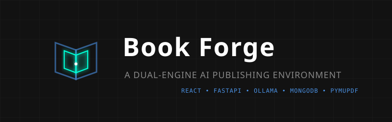
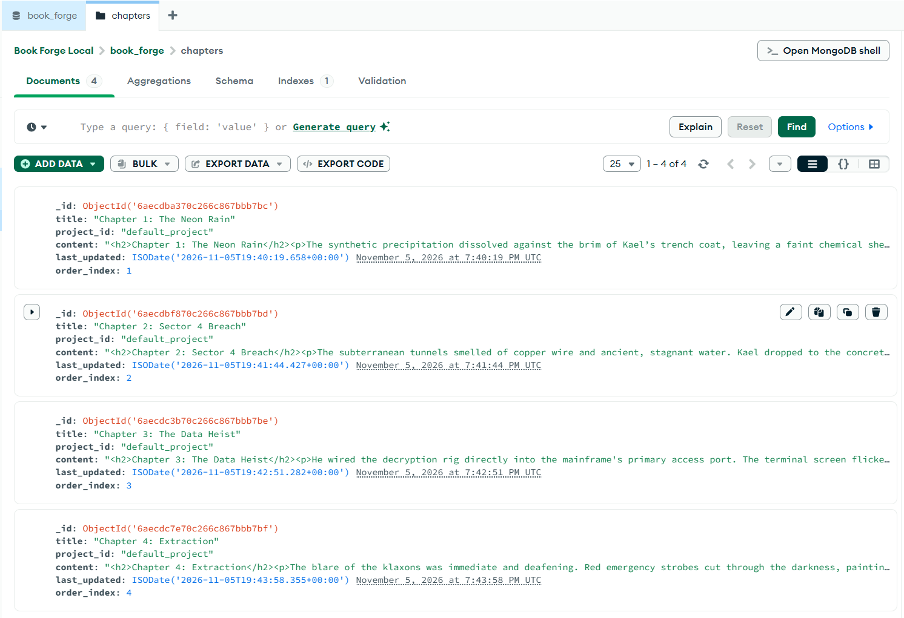

# Book Forge

<div align="center">
  <!-- Replace banner.png with your professional header image in the public folder -->
  

**A Dual-Engine AI Publishing & Authoring Environment**

</div>

---

## Purpose & Intent

Book Forge is a local, privacy-first writing and document mastery platform. Originally designed for authoring and structuring 200–300 page book manuscripts using a Scrivener-style architecture, its strict architectural formatting and AI integration make it equally powerful for corporate drafting, legal documentation, and technical reports.

It combines a React-based word processor with a Python PyMuPDF backend, allowing users to draft in a clean, distraction-free interface while a local LLM agent acts as a collaborative editor.

When the draft is ready, the backend pulls the ordered chapters from a local database and binds the HTML into a professionally formatted Master PDF.

## Core Features

- **The Canvas:** A headless Tiptap React editor with an auto-save buffer to prevent data loss.
- **Scrivener-Style File Tree:** A dynamic sidebar backed by MongoDB to organize manuscripts chapter by chapter, preventing DOM performance degradation on massive documents.
- **Draggable AI Agent:** A free-floating, collapsible UI panel dynamically connected to your local Ollama models (e.g., `qwen2.5-coder:3b`). Execute precise, coordinate-based text rewrites, dialogue punch-ups, and grammar polishing without losing focus. Includes dynamic "Personas" for creative, corporate, or legal tones.
- **The Binder Engine:** A FastAPI Python backend utilizing `fitz.DocumentWriter` to safely render HTML/CSS directly into physical PDF files with automatically generated Tables of Contents.
- **100% Local Privacy:** No cloud dependencies for AI processing, data storage, or document rendering.

---

## Proof of Concept: In-Browser AI & Mastering

<div align="center">
  <video src="https://github.com/user-attachments/assets/3c62e149-3d3c-48c0-bea6-5fef735b2653" width="100%" controls autoplay loop muted></video>
</div>

---

## Local Database Architecture (MongoDB)

Book Forge bypasses traditional rigid file systems by utilizing a local MongoDB Document Database. This architecture allows the React frontend to seamlessly manage multi-hundred-page manuscripts without DOM lag.

Each chapter is stored as a distinct JSON document containing the following schema:

- `_id`: Unique Object Identifier.
- `title`: The designated chapter title or intelligent OCR scan header.
- `project_id`: Allows for multi-book sorting (defaults to `default_project`).
- `content`: The raw HTML payload generated by the Tiptap canvas.
- `last_updated`: ISO timestamp for version control tracking.
- `order_index`: An integer mapped directly to the drag-and-drop Assembly Room UI for instant reordering.

<div align="center">
  
</div>

---

## Prerequisites

Before installing Book Forge, ensure the following dependencies are active on your local machine:

- **Node.js:** v18 or newer.
- **Python:** 3.10 or newer.
- **MongoDB Community Server:** Installed and running locally on the default port `27017`.
- **Ollama:** Installed and running locally with the `qwen2.5-coder:3b` model pulled.
- **Tesseract OCR (Portable):** Required for the _Import Scan_ feature. A Windows portable binary must be staged in the backend (details in Getting Started).

---

## Getting Started

### 1. Clone the Repository

```bash
git clone [https://github.com/YourUsername/book-forge.git](https://github.com/YourUsername/book-forge.git)
cd book-forge
```

### 2. Stage the OCR Binary (Tesseract)

> For the Import Scan image-to-text pipeline to function, Book Forge requires a portable Tesseract executable.

- Download a portable Windows Tesseract build.

- Extract it into the repository at this exact path:`backend/bin/tesseract/tesseract.exe`(_Note: If you prefer a system-level install, simply update the `TESSERACT_PATH` variable inside `backend/core/scanner.py` to match your local environment_).

### 2. Start the Binder Engine (Backend)

Open your first terminal and initialize the Python backend. Ensure your local MongoDB instance is actively running and that you have created a .`env` file in the `backend/` directory containing: `MONGO_URI="mongodb://localhost:27017`"

**PowerShell:**

```powershell
cd backend
python -m venv .venv
.\.venv\Scripts\activate
pip install -r requirements.txt
python main.py
```

The API will start at:

`http://127.0.0.1:8000`

### 3. Start the Authoring Canvas (Frontend)

Open a second terminal window and initialize the React interface.

**PowerShell:**

```powershell
cd frontend

npm install

npm run dev
```

The Authoring Canvas will start at:

`http://localhost:5173`

---

## Usage

- Open the Authoring Canvas in your browser.

- Use the sidebar to create a + New chapter.

- Draft your document or paste in existing raw text. (Your work is auto-saved to a local browser buffer as you type).

- Highlight any text you wish to improve, configure the Forge Agent's persona, and choose an editing action.

- Click Save to Database to permanently write the chapter to MongoDB.

- Click Bind Current Chapter to render a local PDF of your active screen.

- Your finished PDF will be saved in:

```text
backend/assets/master_outputs/
```

---

## Roadmap & TL;DR

[x]: Vite/React shell, headless Tiptap canvas, and portable Tesseract OCR binary staging.

[x]: Free-floating draggable Ollama agent with dynamic model mapping and coordinate-based text replacement.

[x]: MongoDB database integration, Scrivener-style sidebar file tree, and CRUD functionality.

[x] Phase 7 (Mastering Pipeline): Built the Assembly Room dashboard to drag-and-drop chapter ordering, select global CSS themes (Book, Corporate, Legal), and compile the final multi-chapter PDF.

[x] Phase 8 (The OCR Bridge): Connected the frontend to the staged Tesseract/pdfplumber binaries, allowing users to upload physical page scans, intelligently parse titles, and automatically convert them into tiled MongoDB chapters.

### _Book Forge — Write locally. Edit intelligently. Publish professionally._
